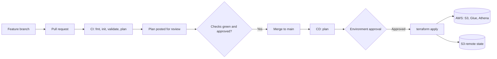

# COB Data Platform: Terraform with CI/CD

A small AWS lakehouse (S3, Glue, Athena) provisioned entirely through the COB module library, with every infrastructure change checked, reviewed and deployed by an automated GitHub Actions workflow.

This is Phase 2 of Project COB. Phase 1 produced the reusable Terraform modules. This repository is the first customer of that platform, and it aims to display how CI-CD can be implemented from A to Z

---

## Table of contents

1. [How it works](#how-it-works)
2. [Repository layout](#repository-layout)
3. [The data platform](#the-data-platform)
4. [Consuming COB](#consuming-cob)
5. [Configuration](#configuration)
6. [Remote state](#remote-state)
7. [Authentication](#authentication)
8. [The pipeline](#the-pipeline)
9. [Making a change](#making-a-change)
10. [Demonstrated scenarios](#demonstrated-scenarios)
11. [Production practices](#production-practices)
12. [Engineering decisions](#engineering-decisions)
13. [Known gaps and next steps](#known-gaps-and-next-steps)
14. [Troubleshooting](#troubleshooting)
15. [Lessons learned](#lessons-learned)

---

## How it works

Nobody applies infrastructure from a laptop. A change travels through one path, and every stage has to pass before the next one starts.



In short:

- A pull request triggers validation and a plan. The plan is published on the pull request so reviewers can read it.
- Branch protection blocks the merge until all checks pass and a reviewer approves.
- A merge into `main` triggers deployment. A named approver has to release the apply step.
- Only one deployment can run against a given state at a time.

---

## Repository layout

```
.
├── .github/
│   └── workflows/
│       ├── terraform-ci.yml    # pull request checks and plan
│       └── terraform-cd.yml    # plan, approval and apply on main
├── dev/
│   ├── main.tf                 # module calls
│   ├── providers.tf            # Terraform and provider versions
│   ├── backend.tf              # remote state configuration
│   ├── variables.tf            # input variable declarations
│   ├── terraform.tfvars        # values for the dev environment
│   └── outputs.tf
├── docs/                       # architecture diagram and extra notes
├── .gitignore
└── README.md
```

Each environment gets its own folder and its own state file. Adding `prod` later means adding a `prod/` folder and a matching pipeline environment.

---

## The data platform

The platform is a minimal lakehouse. Raw files land in S3, a Glue crawler catalogues them, and Athena queries them.

- **read_lakehouse**: S3 bucket for raw data (storage module)
- **results_lakehouse**: S3 bucket for Athena query results (storage module)
- **crawler_role**: IAM role assumed by Glue (IAM module), with the AWS managed `AWSGlueServiceRole` policy plus a custom statement granting read access to the raw bucket
- **data_platform**: Glue and Athena resources (data platform module), pointed at the `raw/` prefix of the raw bucket and the `athena-results/` prefix of the results bucket

Region: `af-south-1`. Environment: `dev`.

Resources reference each other through module outputs, for example `module.read_lakehouse.bucket_arn`. Nothing depends on a hardcoded bucket name, and Terraform works out the creation order on its own.

---

## Consuming COB

The modules live in a separate repository, `project-cob`, and are pulled in by Git tag:

```hcl
module "read_lakehouse" {
  source = "git::https://github.com/mumi-nah/project-cob.git//modules/storage?ref=v1.0.0"

  environment    = var.environment
  bucket_purpose = "raw-lh"
}
```

A few things worth knowing:

- The double slash separates the repository from the module folder inside it.
- `?ref=v1.0.0` pins the module to a release. Without it, Terraform would use whatever is on the default branch, and a change to a module could alter this platform's plan without any change in this repository.
- Upgrading is a deliberate act: change the tag, open a pull request, and review the resulting plan.
- Tags follow semantic versioning. A patch is a bug fix, a minor version is a backward compatible addition, and a major version is a breaking change.
- Module labels must be unique within a configuration. Two calls to the same storage module are fine as long as the labels differ.

If COB lacks something the platform needs, the gap is documented (see [Known gaps](#known-gaps-and-next-steps)) with a decision on whether it belongs in the module or stays specific to this application. Modules are never recreated inside this repository.

---

## Configuration

Inputs are declared in `variables.tf` and given values in `terraform.tfvars`.

- `aws_region`: region to deploy into
- `environment`: environment name, passed to every module and used in resource tags

`terraform.tfvars` is committed, so it must never contain secrets.

---

## Remote state

State is stored in S3, because the pipeline runs on a fresh machine every time and a local state file would not survive.

- Versioning is enabled, so earlier state files can be recovered
- Encryption is enabled
- Public access is blocked
- Locking uses the native S3 lock file (`use_lockfile = true`), which stops two runs from modifying the same state at once

```hcl
terraform {
  backend "s3" {
    bucket       = "<state-bucket-name>"
    key          = "data-platform/dev/terraform.tfstate"
    region       = "af-south-1"
    use_lockfile = true
  }
}
```

The state bucket is created once, manually, because Terraform cannot store state in a bucket that does not exist yet. The `key` includes the environment name so each environment keeps separate state.

---

## Authentication

The pipeline authenticates to AWS with OpenID Connect (OIDC). GitHub issues a short lived token for each run, AWS verifies it, and the run receives temporary credentials. No long lived access keys exist in GitHub or in the code.

AWS side:

- An OIDC identity provider for `token.actions.githubusercontent.com`, with the audience `sts.amazonaws.com`
- An IAM role whose **trust policy** only allows this repository to assume it, using a condition on the `sub` claim
- A **permissions policy** attached to the role, granting access to the state bucket and to the services this platform manages

GitHub side:

- A repository variable named `AWS_ROLE_ARN` holding the role ARN
- `id-token: write` permission in the workflow

The trust policy and the permissions policy are different things. The trust policy says who may assume the role and contains a `Principal`. The permissions policy says what the role may do and contains none. They are edited in different places in the AWS console.

---

## The pipeline

### CI: `terraform-ci.yml`

Runs on every pull request into `main`.

1. **Checkout** the repository
2. **Set up Terraform** at the pinned version
3. **Format check** with `terraform fmt -check -recursive`
4. **Configure AWS credentials** through OIDC
5. **Init** against the remote backend
6. **Validate** the configuration
7. **Plan** and save it to a file
8. **Upload the readable plan output** as a short-lived downloadable artifact for pull request review

Each step has to succeed for the next one to run. A failure stops the job and marks the check red.

### Review and approval

- Branch protection on `main` requires a pull request, at least one approving review, and a passing CI check
- Direct pushes to `main` are blocked
- Reviewers download and inspect the plan artifact from the pull request's Actions run. Look for resources being destroyed or replaced, anything being exposed publicly, and changes that could raise cost

Passing CI does not apply anything. A plan is only a proposal.

### CD: `terraform-cd.yml`

Runs on pushes to `main`.

1. **Plan job** creates a saved plan from the pushed code, shows its readable output in the Actions run summary, and uploads the saved plan as a short-lived artifact
2. **Apply job** waits for the plan job and is bound to the `dev` GitHub Environment, which can require an authorised reviewer to approve before the job starts
3. After approval, the apply job downloads the saved plan from that same workflow run and applies exactly that plan

Safety controls:

- Triggers only on pushes to `main`
- Uses a `concurrency` group for `dev` with `cancel-in-progress: false`, so deployments queue instead of overlapping and an apply in progress is never interrupted
- State locking provides a second layer of protection against conflicting writes
- The saved plan artifact is retained for one day; treat it as sensitive because Terraform plans may contain sensitive values
- A failure at any stage stops the run before the next stage begins

---

## Making a change

1. Update `main` and create a branch: `git checkout -b my-change`
2. Edit the Terraform code in `dev/`
3. Format it locally: `terraform fmt -recursive`
4. Commit and push the branch
5. Open a pull request into `main`
6. Wait for the checks and read the plan comment
7. Request a review and address any feedback
8. Merge once approved and green
9. Approve the deployment when the `dev` environment prompts for it
10. Check the run summary to confirm the apply succeeded

If a check fails, open the failed step in the Actions tab, read the log, fix the problem on the same branch and push again. The pull request updates and the checks rerun automatically.

### Running locally

Useful for experimenting before opening a pull request. This needs AWS credentials on the machine.

```
cd dev
terraform init
terraform fmt -check -recursive
terraform validate
terraform plan
```

Local `apply` is reserved for the initial bootstrap. After that, deployments go through the pipeline.

---

## Demonstrated scenarios

Evidence for each scenario is in `docs/evidence/`.

### Scenario A: a valid change

A configuration change is made on a branch and a pull request is opened. The checks pass, the plan comment shows the proposed change, a reviewer approves, and the merge triggers CD. After the environment approval the change is applied, and the new configuration is visible in AWS.

### Scenario B: invalid Terraform

A deliberate error is introduced on a separate branch. The validate step fails, the pull request shows a red check, the merge button is blocked, and nothing reaches AWS.

### Scenario C: repeatability

The workflow runs again with no changes. The plan reports that the infrastructure already matches the configuration, no resources are created or destroyed, and the run finishes cleanly. This confirms the configuration is idempotent and the pipeline handles an unchanged environment sensibly.

---

## Production practices

- Module versions pinned to Git tags
- Terraform and provider versions pinned, with `.terraform.lock.hcl` committed
- Remote state with versioning, encryption, blocked public access and locking
- No secrets in code, and no state files in Git
- Format, validate and plan required on every pull request
- Plan visible to reviewers before anything is applied
- Human approval before deployment
- Apply only from `main`
- Concurrency control so deployments never overlap
- Short lived credentials through OIDC
- Default tags on all resources for traceability

---

## Engineering decisions

- **Separate repositories for modules and consumer.** Clear ownership and independent versioning. The cost is that the pipeline runner must be able to download the modules repository, so it either has to be public or needs a token.
- **Pinned module tags.** Upgrades are less automatic but predictable and reviewable.
- **One folder per environment.** A little duplication in exchange for separate configuration and separate state.
- **CI on pull requests, CD on `main`.** Each workflow has one job, and checks are never duplicated on merge.
- **Saved plan applied after approval.** What the reviewer approved is exactly what gets applied, with no surprise from a second plan.
- **OIDC over stored access keys.** Slightly more setup, but nothing long lived can leak.
- **Broad permissions for the pipeline role.** The role currently allows wide access to S3, Glue, Athena and IAM so the pipeline could be built quickly. This is the main security trade-off in the project, and it should be narrowed (see below).
- **Single role for plan and apply.** Simple to operate. A stricter design splits a read only role for pull requests from a write role limited to the protected environment.

---

## Known gaps and next steps

Gaps found in COB while building this platform:

- The storage module does not yet support KMS encryption or access logging. These belong in the module and are candidates for a future minor release.
- An Athena workgroup matters in production: it fixes the query results location, can enforce it, caps data scanned per query and controls result encryption. If the data platform module does not create one, it belongs in the module and would ship as `v1.1.0`.

Planned improvements:

- Scope the pipeline role to specific resource ARNs and actions
- Split the plan role from the apply role
- Add cost estimation to the pull request checks
- Add static analysis for security misconfigurations
- Add a `prod` environment with its own state and stricter approvals

---

## Troubleshooting

- **`No configuration files` on plan:** Terraform only reads `.tf` files in the current directory. Move into `dev/` first.
- **`Duplicate module call`:** two module blocks share a label. Every label must be unique, and every `module.<label>` reference must match it.
- **Format check fails with exit code 3:** run `terraform fmt -recursive` locally, commit the result and push again.
- **`Failed to install provider` or DNS errors on init:** a network problem, not a code problem. Retry on a stable connection.
- **`Not authorized to perform sts:AssumeRoleWithWebIdentity`:** the role's trust policy does not match the token GitHub sent. Check that the `sub` condition matches the repository name exactly (it is case sensitive), that the audience is `sts.amazonaws.com`, and that the workflow has `id-token: write`.
- **Red squiggles in the AWS policy editor:** a trust policy has been pasted into the permissions policy editor, or the other way round.
- **No pull request banner after a second push:** a pull request already exists, and the new commit joined it.

---

## Lessons learned

- Get everything working by hand first. A pipeline is a set of manual commands run by a robot, so a manual success makes later failures easy to place.
- The pipeline machine starts empty on every run. Code, tools, credentials and state all have to be provided deliberately.
- Versioning is what makes infrastructure changes traceable, reviewable and reversible.
- Read errors by layer: network, authentication, permissions, then code. It narrows the search quickly.
- Security trade-offs are acceptable when they are made knowingly and written down.
- Building the pipeline in small pieces, each one green before the next, keeps the work manageable.